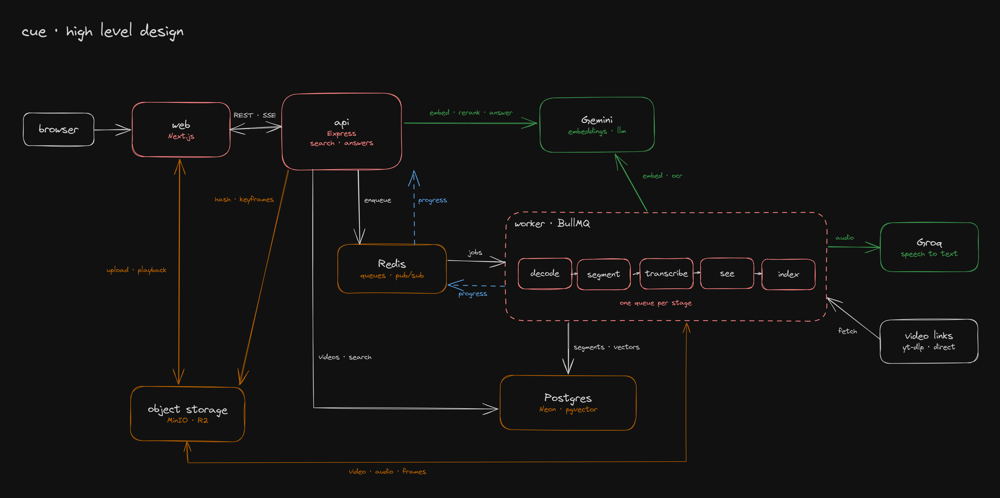

# cue

Multimodal video search. Upload hours of video, ask in plain language, get back timestamped clips, ranked and explained.

Cue indexes what is said (transcript), shown (frames) and written on screen (OCR), then answers queries with hybrid vector + keyword retrieval, a reranker and short answers that
cite the exact moments.



## Stack

- **web**: Next.js
- **api**: Express
- **worker**: BullMQ on Redis, one queue per pipeline stage
- **db**: Drizzle + Neon Postgres with pgvector
- **storage**: S3-compatible (MinIO, locally and on the deploy box)
- **models**: free tiers of Groq (speech) and Gemini (embeddings, OCR, rerank, answers), behind
  provider interfaces

## Layout

```
apps/web                 next.js ui
apps/api                 express api
apps/worker              pipeline workers
packages/db              schema, client, migrations
packages/core            env, queues, providers, storage
packages/tsconfig        shared tsconfig
packages/eslint-config   shared eslint config
infra/compose.yml        local redis and minio
infra/compose.prod.yml   full stack behind caddy for a vm
docs/                    architecture, api, components and decision records
```

## Quickstart

Requires Node 22+, pnpm 10, Docker, a Neon database and free Groq and Gemini keys.

```bash
pnpm install
cp .env.example .env        # set DATABASE_URL, GROQ_API_KEY, GEMINI_API_KEY
pnpm infra:up               # redis + minio
pnpm db:migrate
pnpm dev                    # web :3000, api :4000, worker
```

Full setup, env reference and resets are in [docs/local.md](docs/local.md). To put it on a
server, see [docs/deploy.md](docs/deploy.md).

## Scripts

| Script             | What it does                         |
| ------------------ | ------------------------------------ |
| `pnpm dev`         | api, worker and web in watch mode    |
| `pnpm check`       | lint, typecheck and test             |
| `pnpm build`       | production build                     |
| `pnpm format`      | format with prettier                 |
| `pnpm db:generate` | generate a migration from the schema |
| `pnpm db:migrate`  | apply migrations to `DATABASE_URL`   |

## How it works

`decode → segment → transcribe → see → index`, each stage idempotent and resumable via `stage_runs`.
Search runs filters, hybrid retrieval, rerank and clip assembly on every query.

| Doc                                          | What it covers                      |
| -------------------------------------------- | ----------------------------------- |
| [docs/architecture.md](docs/architecture.md) | how the parts fit together          |
| [docs/api.md](docs/api.md)                   | every HTTP endpoint                 |
| [docs/local.md](docs/local.md)               | running it on your machine          |
| [docs/deploy.md](docs/deploy.md)             | running it on any linux vm          |
| [docs/components](docs/components/README.md) | how search, rerank and answers work |
| [docs/decisions](docs/decisions/README.md)   | why the big choices were made       |
| [docs/RESOURCES.md](docs/RESOURCES.md)       | reading list for the build          |

## Status

Ingest and search work end to end:

- **Ingest**: upload or link, content-hash dedupe, scene detection, transcription with word
  timings, keyframe embeddings and OCR, text embeddings with a cache, live progress in the UI.
- **Search**: hybrid retrieval, rerank with reasons, clips snapped to word boundaries, grounded
  answers with clickable citations.

Next: evals (retrieval recall, timestamp accuracy, ablations, cost and latency), then hardening
and a shorts generator. Ranking thresholds are still first guesses until the evals tune them.
